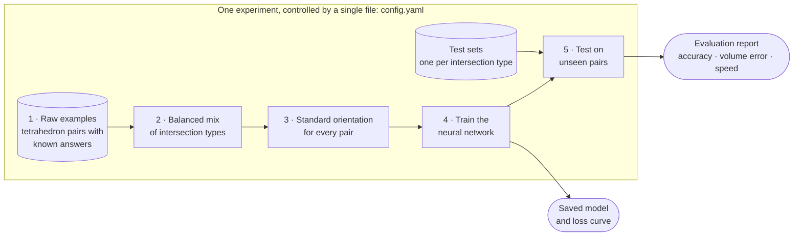
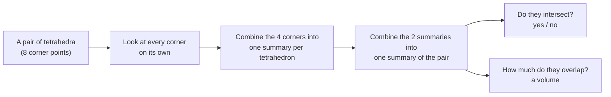

# Learning Tetrahedron-Tetrahedron Intersection and Volume with Neural Networks

# Introduction

## The Problem

Picture a sword slicing through water in a video game. Or a drone navigating debris. Or a medical simulation tracking tissue deformation.

These moments all rely on a silent operation: **did these two 3D shapes intersect, and by how much?**

To answer that, we often break complex shapes down into **tetrahedrons**. They’re the atomic unit of 3D geometry—simple, rigid, and expressive. Whether you're simulating physics, running FEM analyses, or building collision systems, it often comes down to tetrahedron-tetrahedron interaction. It sounds trivial, but the geometry isn't forgiving. Tetrahedron-tetrahedron intersection is an edge case minefield—six faces, four points, endless configurations. The computation is clean in theory, but slow and branching in practice.

Now scale that to millions of pairs per frame.

## Enter Machine Learning

Rather than solving the same geometric predicates again and again, what if we **learned the outcome directly from data**?

Instead of step-by-step logic trees, imagine a neural network trained to recognize intersection patterns. One that doesn’t follow rigid instructions but learns the behavior of tetrahedrons through thousands of examples. And instead of one CPU doing one pair at a time, we batch it, **processing thousands of pairs in parallel on a GPU**.

That's the core idea:  
**Replace brittle logic with learned geometric intuition**, and exploit the parallel nature of deep learning for real-time scalability.

This approach shifts the bottleneck. It trades exactness for speed, while still delivering reliable estimates, especially useful in applications that demand high throughput: physics engines, medical scans, robotics planning.


# Installation Guide

## Prerequisites

### Git LFS (Large File Storage)

This repository uses **Git LFS** to store large CSV data files. You must install and initialize Git LFS before cloning or pulling data.

```bash
# Install Git LFS (Ubuntu/Debian)
sudo apt install git-lfs

# Initialize Git LFS
git lfs install

# Pull the actual data files (after cloning)
git lfs pull
```

> **Note:** Without Git LFS, data files will appear as small pointer files instead of the actual CSV data.

### Python Environment

```bash
# Create a virtual environment
python3 -m venv .tetra-ml

# Activate it
source .tetra-ml/bin/activate

# Install dependencies
pip install -r requirements.txt

# Optional: tests and the analysis notebook
pip install -r requirements-dev.txt
python -m pytest
```

# Pipeline Overview

---

Every experiment, transformation, and model choice is traceable and interchangeable.

## From raw geometry to a verdict

One experiment is five steps. Data goes in on the left, a trained model and a report come out on the right, and a single file, `config/config.yaml`, controls everything in between.



1. **Raw examples** are pairs of tetrahedra labelled with the true answer: do they intersect, and what is the overlap volume?
2. **Balanced mix**: the pairs are sampled so every kind of intersection (none, point, segment, polygon, polyhedron) is represented in the proportions you choose.
3. **Standard orientation**: with the default `principal_axis` transformation, each pair is moved and rotated into a canonical pose, so the network never has to care where in space a pair happens to be.
4. **Train** the network to answer both questions at once.
5. **Test** on pairs it has never seen, grouped by intersection type, and measure accuracy, volume error, robustness to reordering the corners, and speed.

## What the network does with a pair



The two combining steps use order-independent operations (such as taking the maximum), so that listing the corners, or the two tetrahedra, in a different order matters as little as possible. Shortcut connections keep some positional information, so the answer is not guaranteed to be identical, and the evaluation measures how consistent the answers really are when the order is shuffled.

## Where each step lives

| Step | Code |
| --- | --- |
| 1-3 Prepare the data | `src/data_processing/` (sampling, transformations) and `src/utils/` (geometry, dataset files) |
| 4 Build and train | `src/models/`, `src/training/` |
| 5 Test | `src/evaluation/` |
| Run everything and save the results | `src/pipeline/` (orchestrator, config checks), `src/artifacts.py` |

Run an experiment with `python main.py`. Each run creates a folder in `artifacts/` holding the config used, the saved model, the loss curve and the evaluation report. Bad settings are reported up front, before any work starts.

